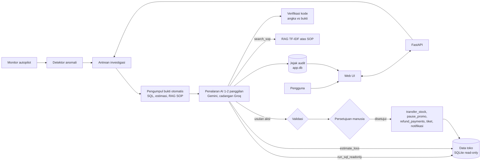

# OpsPilot

**AI agent otonom untuk investigasi anomali operasional retail.** GTNIC 2026, sub tema Enterprise Productivity.

OpsPilot memantau data toko secara berkala. Begitu menemukan anomali, OpsPilot mengumpulkan bukti lewat tool (SQL read-only, estimasi kerugian, RAG atas SOP), lalu AI (**Gemini**, dengan **Groq** sebagai cadangan opsional) menalar akar masalah dan mengusulkan tindakan yang benar-benar mengubah data (transfer stok, hentikan promo, refund pelanggan, tiket, notifikasi). Setiap angka dalam kesimpulan AI diverifikasi kode terhadap bukti. Desainnya hemat kuota: 1-2 panggilan AI per investigasi, sehingga tetap jalan di API gratis. Tidak ada tindakan yang dijalankan tanpa persetujuan manusia.

## Fitur utama

| Fitur | Penjelasan |
|---|---|
| Autopilot (opsional) | Monitor latar belakang untuk data toko sintetis; nonaktif secara default, aktifkan dengan `OPSPILOT_AUTOPILOT=1` |
| Investigasi hemat kuota | Bukti dikumpulkan otomatis lewat tool (SQL, estimasi kerugian, RAG SOP); AI menalar dalam 1-2 panggilan dan boleh meminta query tambahan |
| Verifikasi berbasis kode | Setiap angka di klaim AI dicocokkan dengan bukti yang dirujuk; bila tidak cocok, AI diminta memperbaiki satu kali |
| Multi-penyedia AI | Gemini (utama) dan Groq (cadangan opsional), pembatas permintaan per menit, pindah otomatis saat kuota habis |
| Mode tanpa AI | Bila semua model AI habis kuota, diagnosis berbasis aturan tetap berjalan dengan label jelas |
| Aksi nyata dengan persetujuan | `transfer_stock`, `pause_promo`, dan `refund_payments` mengubah database setelah disetujui, lalu hasilnya diverifikasi |
| Tindakan simulasi yang jujur | Tiket dan notifikasi untuk kasus nyata dicatat di OpsPilot (tidak dikirim ke perusahaan atau pihak luar) dan ditandai jelas sebagai simulasi; penerima ditulis sebagai tim/jabatan, alamat email dan nomor telepon karangan AI dibuang otomatis |
| Usulan tindakan lengkap | Setiap usulan memuat alasan (merujuk ID bukti), 2-5 langkah penyelesaian, PIC, target waktu sesuai prioritas, dan kriteria masalah dianggap selesai |
| Progres langsung | Setiap langkah agent tampil di UI saat terjadi |
| Jejak audit | Semua investigasi, langkah, usulan, dan keputusan tersimpan di database terpisah |
| Hapus riwayat | Riwayat riset dan investigasi bisa dihapus per item atau semuanya; temuan yang investigasinya dihapus bisa dianalisis ulang |
| Pantau perusahaan | Perusahaan di daftar pantau diriset ulang otomatis (default tiap 24 jam, `OPSPILOT_WATCH_INTERVAL_HOURS`) dan masalah yang belum pernah terlihat ditandai **Baru** |
| Laporan analisis | Setiap investigasi bisa diunduh sebagai laporan siap cetak / PDF (kasus, sumber, analisis, usulan tindakan, bukti) |
| Ringkasan | Halaman utama menampilkan jumlah perusahaan diriset, kasus dianalisis, kasus risiko tinggi, dan tindakan disetujui |
| Mode rekaman | Bila Gemini sedang sibuk saat demo, investigasi sebelumnya bisa diputar ulang dengan label jelas "rekaman" |
| Riset perusahaan nyata | Ketik nama perusahaan apa pun; OpsPilot mencari masalah operasional terbarunya lewat Google Search, memverifikasi sumber, menilai dampak, dan merujuk SOP |
| Analisis kasus nyata | Temuan riset dijadikan anomali yang sama persis dengan masalah aslinya, lalu agent menganalisis dan mengusulkan solusinya |
| Evaluasi otomatis | 13 skenario dengan akar masalah diketahui; akurasi diagnosis, ketepatan aksi, keamanan, dan waktu diukur otomatis |

## Arsitektur



| Komponen | Teknologi |
|---|---|
| LLM | Gemini (Google GenAI SDK) + Groq opsional (OpenAI-compatible API), keluaran JSON terstruktur, pembatas per menit, fallback otomatis |
| Backend | Python, FastAPI, thread worker dan monitor |
| Data | SQLite: data toko sintetis 30 hari (4 gerai, 8 produk, penjualan, stok, pembayaran, pesanan, dan keluhan pelanggan) + database audit terpisah |
| RAG | TF-IDF (scikit-learn) atas 10 dokumen SOP di `data/sop` |
| Frontend | HTML + JavaScript tanpa framework, polling progres tiap detik |

## Riset perusahaan nyata

1. **Cari:** Gemini dengan Grounding with Google Search menulis temuan dalam format tetap (judul, tanggal, kategori, ringkasan).
2. **Verifikasi (kode, bukan LLM):** setiap temuan dipetakan ke sumbernya lewat metadata grounding. Temuan tanpa sumber dibuang. Temuan yang sumbernya hanya media sosial ditandai "belum terkonfirmasi". Tanggal lebih dari 180 hari atau di masa depan ditandai.
3. **Analisis:** AI menilai relevansi (artikel opini, kisah sukses, tips, atau promo ditandai "Bukan masalah operasional perusahaan" dan tidak dianalisis), merumuskan inti masalah dalam satu kalimat, lalu menilai dampak, risiko, dan mitigasi sesuai SOP (RAG).
4. **Analisis di OpsPilot:** temuan dijadikan anomali yang **sama dengan masalah aslinya**, misalnya "Transaksi kartu kredit ditolak, tapi tagihan tetap dibebankan (PT GoTo Gojek Tokopedia Tbk)". Agent mencari berita tambahan tentang kasus itu lewat tool `search_news` (Google News, otomatis, dan AI boleh meminta maksimal 2 pencarian lagi bila penyebab atau tanggapan perusahaan belum jelas), lalu menalar akar masalah dari ringkasan kasus, sumber berita, dan SOP, membedakan fakta dari dugaan, lalu mengusulkan tindakan penyelesaian (tiket ke tim pemilik masalah, notifikasi ke pelanggan atau manajemen) lengkap dengan langkah, PIC, target waktu, dan kriteria selesai. Semua tindakan menunggu persetujuan manusia.

**Cadangan Google News:** bila Google Search di Gemini kena batas kuota, OpsPilot mengambil artikel terbaru dari Google News RSS (gratis, tanpa API key), memberi setiap artikel ID (A1, A2, ...), lalu AI (Gemini atau Groq) mengelompokkan masalah yang wajib merujuk ID artikel. Kode membuang temuan yang merujuk artikel yang tidak ada. Mode sumber selalu ditampilkan di hasil riset.

Temuan selalu berasal dari sumber publik, bukan data internal perusahaan. Nama perusahaan dari pengguna dibersihkan dan dibatasi 80 karakter sebelum dipakai di prompt.

## Skenario anomali

| ID | Kasus | Tindakan yang diharapkan |
|---|---|---|
| `stockout_bandung_minyak` | Stok habis karena pengiriman terlambat | Transfer stok |
| `stockout_medan_susu` | Stok habis karena pengiriman terlambat | Transfer stok |
| `discount_surabaya_beras` | Diskon 40% di bawah harga pokok | Hentikan promo |
| `discount_jakarta_kopi` | Diskon 50% di bawah harga pokok | Hentikan promo |
| `supplier_gula_multi_toko` | Satu supplier terlambat ke dua toko | Tiket ke Procurement |
| `lonjakan_medan_mie` | Permintaan melonjak, stok menipis | Transfer stok atau tiket |
| `data_pos_jakarta` | Data hilang karena sinkronisasi POS gagal | Tiket IT, tanpa aksi stok/harga |
| `permintaan_turun_jakarta_sabun` | Permintaan turun, stok menumpuk | Tunda pesanan, transfer ke toko yang masih laku |
| `tagihan_ganda_surabaya` | Transaksi kartu ditolak tetapi dana tetap ditagih | Refund pelanggan + tiket Finance |
| `pembayaran_gagal_bandung` | Pembayaran gagal massal, dana tidak terpotong | Tiket IT Payment, tanpa refund |
| `keluhan_aplikasi_jakarta` | Keluhan aplikasi error melonjak | Tiket IT & Product |
| `pesanan_terlambat_medan` | Satu mitra kurir membuat pesanan terlambat | Tiket Logistik + notifikasi pelanggan |
| `toko_tutup_surabaya` | Pendapatan turun karena renovasi terjadwal | Tidak perlu tindakan korektif |

Skenario di tabel ini memakai data toko sintetis dan dipakai untuk autopilot, evaluasi otomatis, dan tes offline. Alur utama demo adalah riset perusahaan nyata lalu **Analisis di OpsPilot**.

## Guardrails dan mitigasi risiko

- SQL hanya `SELECT`, satu statement, koneksi read-only, maksimal 50 baris.
- Database audit terpisah dari data toko, jadi agent tidak bisa membaca atau mengubah jejak audit.
- Usulan aksi divalidasi saat diusulkan dan saat disetujui (stok cukup, toko asal tidak di bawah reorder point, promo memang aktif).
- Usulan ganda otomatis digabung.
- Semua aksi menunggu persetujuan manusia; hasil eksekusi dicek ulang dari database.
- Agent hanya boleh memakai fakta dari hasil tool, dan wajib lolos verifikasi diri.
- Kuota AI: 1-2 panggilan per investigasi, pembatas permintaan per menit, cache riset 24 jam, pindah ke model/penyedia cadangan, lalu mode tanpa AI berlabel atau rekaman.
- API key disimpan di `.env` dan tidak masuk repository.

## Menjalankan secara lokal (Windows)

1. Install Python 3.11 atau lebih baru.
2. Buat file `.env` (lihat `.env.example`):
   ```
   GEMINI_API_KEY=key_kamu
   GEMINI_FALLBACK_MODEL=gemini-3.5-flash
   GROQ_API_KEY=key_groq_kamu   (opsional, cadangan bila kuota Gemini habis)
   ```
   Cek key dengan `cek_key.bat`.
3. Klik dua kali `start.bat`. Browser terbuka otomatis ke http://127.0.0.1:7860.
4. Ketik nama perusahaan di **Riset perusahaan nyata**, lalu klik **Simulasikan di OpsPilot** pada temuan yang ingin diselesaikan.

Cara manual:
```bash
pip install -r requirements.txt
python -m uvicorn backend.main:app --port 7860
```

## Evaluasi dan tes

```bash
python -m backend.evaluate      # atau klik evaluate.bat; butuh API key
python -m tests.test_offline    # atau klik test.bat; tanpa API key
```

Hasil evaluasi tersimpan di `eval/results/` dalam format Markdown dan JSON.

## API

| Method | Endpoint | Fungsi |
|---|---|---|
| GET | `/api/state` | Status autopilot, daftar anomali, riwayat |
| POST | `/api/autopilot` | Aktifkan atau nonaktifkan autopilot |
| POST | `/api/check` | Deteksi anomali sekarang |
| POST | `/api/investigate` | Antrekan investigasi langsung |
| POST | `/api/replay` | Putar rekaman investigasi |
| GET | `/api/runs/{id}?after=n` | Detail investigasi dan langkah baru |
| POST | `/api/decide` | Setujui atau tolak usulan |
| POST | `/api/research` | Mulai riset perusahaan `{"company": "..."}` |
| GET | `/api/research/{id}?after=n` | Hasil riset dan langkah baru |
| POST | `/api/research/{id}/simulate` | Simulasikan satu temuan `{"issue_id": 1}` |
| POST | `/api/reset` | Kembalikan data demo ke kondisi awal |
| POST | `/api/runs/delete` | Hapus investigasi (`{"ids": [...]}`, kosong = semua) |
| POST | `/api/research/delete` | Hapus riwayat riset (`{"ids": [...]}`, kosong = semua) |
| GET | `/api/runs/{id}/report` | Laporan analisis siap cetak / PDF |
| POST | `/api/watchlist` | Pantau perusahaan `{"company": "...", "research_id": "..."}` |
| POST | `/api/watchlist/remove` | Berhenti memantau `{"company": "..."}` |
| POST | `/api/watchlist/check` | Riset ulang sekarang (satu perusahaan atau semua) |

## Struktur

```
backend/
  llm.py        Gemini + Groq, pembatas kecepatan, fallback
  evidence.py   pengumpulan bukti otomatis per jenis anomali
  agent.py      penalaran AI + verifikasi berbasis kode
  rules.py      diagnosis berbasis aturan (mode tanpa AI)
  tools.py      tool baca, tool aksi, validasi
  detect.py     detektor anomali
  scenarios.py  data sintetis dan skenario
  research.py   riset perusahaan lewat Google Search dan verifikasi sumber
  news.py       Google News RSS: cadangan riset dan tool search_news
  report.py     laporan analisis siap cetak / PDF
  simulate.py   temuan riset menjadi anomali kasus nyata
  engine.py     antrean investigasi, riset, pemantauan perusahaan, mode rekaman
  store.py      jejak audit dan rekaman
  main.py       API
  evaluate.py   evaluasi otomatis
frontend/index.html
data/sop/       dokumen SOP untuk RAG
data/recordings/ rekaman investigasi untuk mode cadangan
tests/          tes offline dengan Gemini tiruan
```

## Deploy (link publik)

Repo ini sudah berisi `render.yaml` (Render) dan `Dockerfile` (Hugging Face Spaces, Railway, atau hosting Docker lain).

**Render (gratis, otomatis update setiap push ke `main`):**
1. Daftar di [render.com](https://render.com) dengan akun GitHub.
2. **New +** → **Blueprint** → pilih repo `opspilot`. Render membaca `render.yaml`.
3. Isi `GEMINI_API_KEY` (wajib) dan `GROQ_API_KEY` (opsional) saat diminta, lalu **Apply**.
4. Tunggu build selesai (sekitar 3-5 menit). Link publik muncul di dashboard, misalnya `https://opspilot-xxxx.onrender.com`.

Bila tidak memakai Blueprint: **New +** → **Web Service** → pilih repo, Runtime Python, Build command `pip install -r requirements.txt`, Start command `uvicorn backend.main:app --host 0.0.0.0 --port $PORT`, Instance type Free, lalu isi API key di **Environment**.

Catatan paket gratis: server tidur setelah 15 menit tanpa pengunjung (buka pertama butuh sekitar 1 menit), dan riwayat riset/investigasi kembali kosong setiap server restart atau deploy ulang. Siapa pun yang punya link bisa memakai kuota API key, tetapi pembatas permintaan per menit tetap berlaku. API key hanya diisi di dashboard hosting, tidak pernah di kode.
