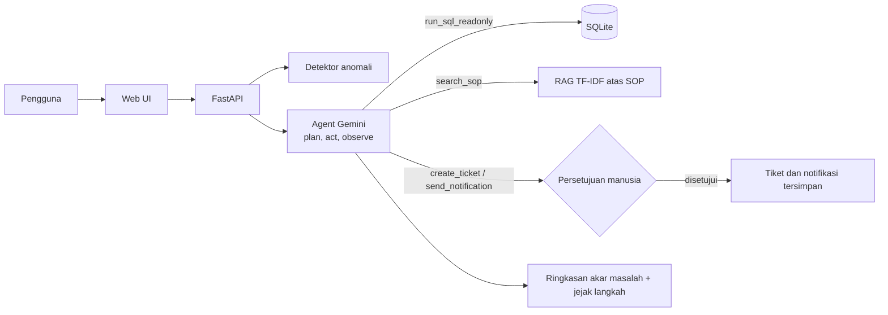

# OpsPilot

**AI agent investigasi anomali operasional retail** — GTNIC 2026, sub tema Enterprise Productivity.

OpsPilot mendeteksi anomali pada data penjualan, lalu sebuah agent berbasis **Gemini** (function calling) merencanakan investigasi, menelusuri bukti lewat SQL, merujuk SOP perusahaan lewat RAG, dan mengusulkan tindakan. Tindakan baru dijalankan setelah disetujui manusia.

## Arsitektur



| Komponen | Teknologi |
|---|---|
| LLM | Gemini (`gemini-3.8-flash`) via Google GenAI API, function calling |
| Backend | Python, FastAPI |
| Data | SQLite, data retail sintetis 30 hari (4 toko, 8 produk) |
| RAG | TF-IDF (scikit-learn) atas dokumen SOP di `data/sop` |
| Frontend | HTML + JavaScript tanpa framework |

## Skenario demo

1. **Pendapatan Bandung Dago turun 25%**: stok Minyak Goreng habis karena pengiriman supplier terlambat; toko Jakarta punya stok berlebih untuk ditransfer.
2. **Diskon tidak wajar pada Beras 5kg di Surabaya Tunjungan**: diskon 40% membuat harga jual di bawah harga pokok.

## Guardrails

- SQL hanya `SELECT`, satu statement, koneksi read-only, maksimal 50 baris.
- Tiket dan notifikasi hanya diusulkan; eksekusi menunggu persetujuan manusia.
- Agent diinstruksikan hanya memakai fakta dari hasil tool.
- Error tool dikembalikan ke agent agar ia memperbaiki query sendiri.
- API key disimpan di `.env` dan tidak masuk repository.

## Menjalankan secara lokal (Windows)

1. Install Python 3.11 atau lebih baru.
2. Buat file `.env` di folder ini (lihat `.env.example`):
   ```
   GEMINI_API_KEY=key_kamu
   ```
3. Klik dua kali `start.bat`. Browser terbuka otomatis ke http://127.0.0.1:7860.

Cara manual:
```bash
pip install -r requirements.txt
python -m uvicorn backend.main:app --port 7860
```

## Struktur

```
backend/   config.py, seed.py, tools.py, agent.py, main.py
frontend/  index.html
data/sop/  dokumen SOP untuk RAG
```

## Deploy

Hugging Face Spaces (SDK Docker, port 7860) atau Render. Isi `GEMINI_API_KEY` di bagian Secrets/Environment, bukan di kode.
