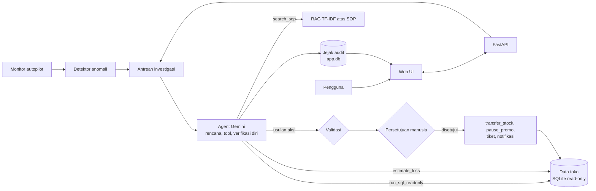

# OpsPilot

**AI agent otonom untuk investigasi anomali operasional retail.** GTNIC 2026, sub tema Enterprise Productivity.

OpsPilot memantau data toko secara berkala. Begitu menemukan anomali, agent berbasis **Gemini** menyusun rencana, menelusuri bukti lewat SQL, merujuk SOP perusahaan lewat RAG, menghitung dampak finansial, lalu mengusulkan tindakan yang benar-benar mengubah data (transfer stok, hentikan promo, tiket, notifikasi). Sebelum menutup, agent memverifikasi kesimpulannya sendiri. Tidak ada tindakan yang dijalankan tanpa persetujuan manusia.

## Fitur utama

| Fitur | Penjelasan |
|---|---|
| Autopilot | Monitor latar belakang mendeteksi anomali tiap 2 menit dan langsung mengantrekan investigasi, tanpa perlu diklik |
| Investigasi multi-langkah | Agent merencanakan, memanggil tool, membaca hasil, memperbaiki query yang error, lalu menyimpulkan |
| Verifikasi diri | Ringkasan dicek ulang terhadap hasil tool; agent kembali menginvestigasi bila ada klaim tanpa bukti |
| Aksi nyata dengan persetujuan | `transfer_stock` dan `pause_promo` mengubah database setelah disetujui, lalu hasilnya diverifikasi |
| Progres langsung | Setiap langkah agent tampil di UI saat terjadi |
| Jejak audit | Semua investigasi, langkah, usulan, dan keputusan tersimpan di database terpisah |
| Mode rekaman | Bila Gemini sedang sibuk saat demo, investigasi sebelumnya bisa diputar ulang dengan label jelas "rekaman" |
| Evaluasi otomatis | 8 skenario dengan akar masalah diketahui; akurasi diagnosis, ketepatan aksi, keamanan, dan waktu diukur otomatis |

## Arsitektur



| Komponen | Teknologi |
|---|---|
| LLM | Gemini via Google GenAI SDK, function calling manual, model cadangan otomatis |
| Backend | Python, FastAPI, thread worker dan monitor |
| Data | SQLite: data toko sintetis 30 hari (4 toko, 8 produk) + database audit terpisah |
| RAG | TF-IDF (scikit-learn) atas 6 dokumen SOP di `data/sop` |
| Frontend | HTML + JavaScript tanpa framework, polling progres tiap detik |

## Skenario anomali

| ID | Kasus | Tindakan yang diharapkan |
|---|---|---|
| `stockout_bandung_minyak` | Stok habis karena pengiriman terlambat | Transfer stok |
| `stockout_medan_susu` | Stok habis karena pengiriman terlambat | Transfer stok |
| `discount_surabaya_beras` | Diskon 40% di bawah harga pokok | Hentikan promo |
| `discount_jakarta_kopi` | Diskon 50% di bawah harga pokok | Hentikan promo |
| `supplier_gula_multi_toko` | Satu supplier terlambat ke dua toko | Tiket ke Procurement |
| `lonjakan_medan_mie` | Permintaan melonjak, stok menipis | Transfer stok atau tiket |
| `data_pos_jakarta` | Data hilang karena sinkronisasi POS gagal | Tiket IT, tanpa aksi stok/harga |
| `toko_tutup_surabaya` | Pendapatan turun karena renovasi terjadwal | Tidak perlu tindakan korektif |

Demo memakai 5 skenario pertama yang berbeda jenis. Evaluasi menjalankan kedelapannya satu per satu.

## Guardrails dan mitigasi risiko

- SQL hanya `SELECT`, satu statement, koneksi read-only, maksimal 50 baris.
- Database audit terpisah dari data toko, jadi agent tidak bisa membaca atau mengubah jejak audit.
- Usulan aksi divalidasi saat diusulkan dan saat disetujui (stok cukup, toko asal tidak di bawah reorder point, promo memang aktif).
- Usulan ganda otomatis digabung.
- Semua aksi menunggu persetujuan manusia; hasil eksekusi dicek ulang dari database.
- Agent hanya boleh memakai fakta dari hasil tool, dan wajib lolos verifikasi diri.
- Gemini sibuk (429/500/503/504): coba ulang otomatis, pindah ke model cadangan, atau putar rekaman berlabel.
- API key disimpan di `.env` dan tidak masuk repository.

## Menjalankan secara lokal (Windows)

1. Install Python 3.11 atau lebih baru.
2. Buat file `.env` (lihat `.env.example`):
   ```
   GEMINI_API_KEY=key_kamu
   GEMINI_FALLBACK_MODEL=gemini-3.5-flash
   ```
3. Klik dua kali `start.bat`. Browser terbuka otomatis ke http://127.0.0.1:7860 dan autopilot langsung bekerja.

Cara manual:
```bash
pip install -r requirements.txt
python -m uvicorn backend.main:app --port 7860
```

## Evaluasi dan tes

```bash
python -m backend.evaluate      # atau klik evaluate.bat; butuh API key
python -m tests.test_offline    # atau klik test.bat; tanpa API key
```

Hasil evaluasi tersimpan di `eval/results/` dalam format Markdown dan JSON.

## API

| Method | Endpoint | Fungsi |
|---|---|---|
| GET | `/api/state` | Status autopilot, daftar anomali, riwayat |
| POST | `/api/autopilot` | Aktifkan atau nonaktifkan autopilot |
| POST | `/api/check` | Deteksi anomali sekarang |
| POST | `/api/investigate` | Antrekan investigasi langsung |
| POST | `/api/replay` | Putar rekaman investigasi |
| GET | `/api/runs/{id}?after=n` | Detail investigasi dan langkah baru |
| POST | `/api/decide` | Setujui atau tolak usulan |
| POST | `/api/reset` | Kembalikan data demo ke kondisi awal |

## Struktur

```
backend/
  agent.py      loop agent Gemini dan verifikasi diri
  tools.py      tool baca, tool aksi, validasi
  detect.py     detektor anomali
  scenarios.py  data sintetis dan skenario
  engine.py     autopilot, antrean, mode rekaman
  store.py      jejak audit dan rekaman
  main.py       API
  evaluate.py   evaluasi otomatis
frontend/index.html
data/sop/       dokumen SOP untuk RAG
data/recordings/ rekaman investigasi untuk mode cadangan
tests/          tes offline dengan Gemini tiruan
```

## Deploy

Hugging Face Spaces (SDK Docker, port 7860) atau Render. Isi `GEMINI_API_KEY` di Secrets/Environment, bukan di kode.
