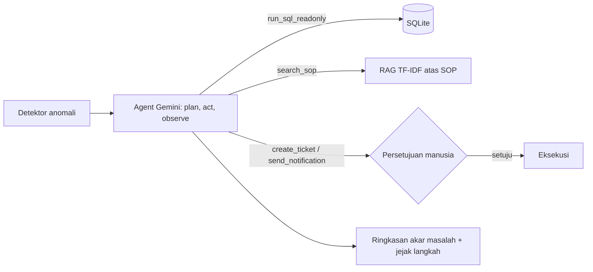

# OpsPilot — Agent Investigasi Anomali Operasional (GTNIC 2026, Enterprise Productivity)

OpsPilot mendeteksi anomali di data retail, merencanakan investigasi, mengambil bukti lewat SQL, merujuk SOP lewat RAG, lalu mengusulkan tindakan yang dieksekusi hanya setelah disetujui manusia.



## Jalankan lokal
```bash
pip install -r requirements.txt
export GEMINI_API_KEY=...        # Windows: set GEMINI_API_KEY=...
uvicorn backend.main:app --port 7860
```
Buka http://localhost:7860. Data sintetis dibuat otomatis (`python -m backend.seed`).

## Guardrails
SQL read-only (koneksi `mode=ro`, hanya SELECT, maks 50 baris) · aksi butuh persetujuan manusia · agent dilarang mengarang data di luar hasil tool · error tool dikembalikan ke agent untuk self-correction.

## Deploy
Hugging Face Spaces (SDK Docker, port 7860) atau Render. Set secret `GEMINI_API_KEY`.
